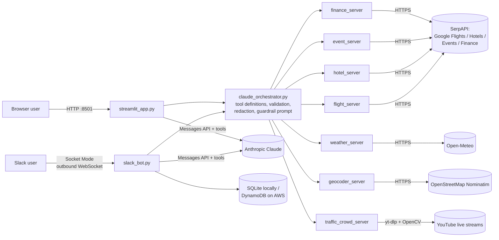
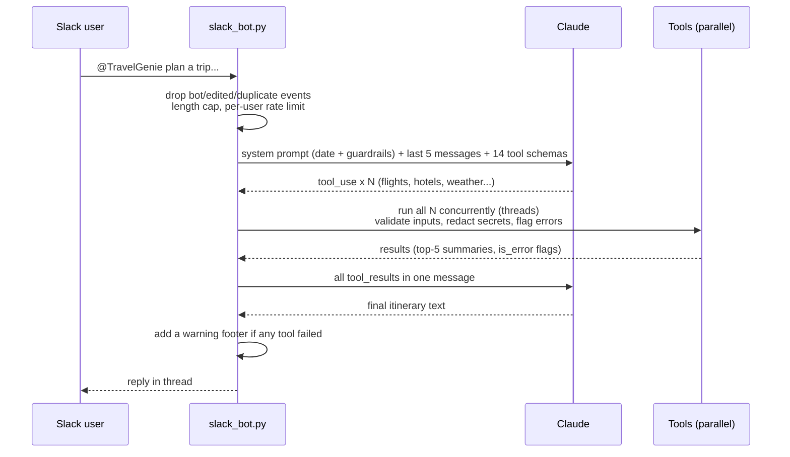

# TravelGenie Architecture

TravelGenie is an AI travel planner. A user asks for a trip in Slack or a web app. Claude (Anthropic's model) decides which tools to call: flights, hotels, events, weather, currency, geocoding, traffic and video analysis. The code runs those tools, sends the results back, and Claude writes the itinerary.

This document covers how the system is built, how a request moves through it, and the design decisions behind it. The security analysis is in [SECURITY_ASSESSMENT.md](SECURITY_ASSESSMENT.md).

---

## 1. Components

| Component | File | Role |
|---|---|---|
| Slack bot | `slack_bot.py` | Receives @mentions, DMs and thread replies over Socket Mode. Runs the Claude tool-use loop, executes tools in parallel, stores history, and applies abuse controls |
| Web app | `streamlit_app.py` | Four tabs: **Plan Trip** (a fixed pipeline with no LLM), **Chat with Claude** (agent), **Individual Searches**, **View Results** |
| Orchestrator | `claude_orchestrator.py` | One shared layer: tool schemas, a dispatcher (`execute_tool`), input validation, secret redaction, error detection, result summarization, and the guardrail system prompt |
| Tool servers | `servers/*/` | 7 Python modules, each also runnable as an **MCP server** (FastMCP) for MCP clients such as Claude Desktop |
| Persistence | `slack_bot.py` `ChatDatabase`, `dynamodb_database.py` | Sessions, messages and a tool-call audit log. SQLite locally, DynamoDB when running on ECS |
| Infrastructure | `aws/cloudformation/infrastructure.yaml`, `Dockerfile` | VPC, ECS Fargate, ECR, DynamoDB, S3, Secrets Manager, CloudWatch alarms and dashboard, autoscaling |

### MCP: how it's actually used
Each capability is packaged as an MCP server (`@mcp.tool()` with FastMCP), so any MCP client can use it. The Slack bot and web app **import the same Python functions directly** and expose them to Claude through the Messages API's tool use. Running seven server processes and an MCP client inside the app would add latency and moving parts with no extra capability. MCP is the reuse and distribution path; direct function calls are the runtime path.

---

## 2. Request lifecycle (Slack)

Key loop rules:
- **Every `tool_use` gets exactly one `tool_result`**, all in a single user message, in order. Claude's turn is sent back **unchanged**, including its thinking blocks.
- **Bounded:** at most 10 model calls per request, each tool result capped at 10,000 characters, and a 20-second timeout on every paid API call.
- **Parallel tools:** they're I/O-bound, so they run in worker threads (`asyncio.to_thread` + `gather`). Nominatim calls are serialized with a lock to respect OpenStreetMap's limit of 1 request per second.

---

## 3. Tool inventory (honest data-source labels)

| Tool | Data source | Live? | Notes |
|---|---|---|---|
| `geocode_location` | OpenStreetMap Nominatim | ✅ | Cities are reliable; street names often not found |
| `calculate_distance` | Geodesic math on geocoded points | ✅ | **Straight-line** distance, not road distance; labeled as such for the model |
| `search_flights` | Google Flights via SerpAPI | ✅ | IATA codes only; returns a top-5 summary to the model |
| `search_hotels` | Google Hotels via SerpAPI | ✅ | Top-5 summary: name, rating, per-night and total price |
| `search_events` | Google Events via SerpAPI | ✅ | Scheduled events (concerts, festivals), not activities. Not filtered to exact travel dates |
| `get_weather_forecast` | Open-Meteo | ✅ | Up to 16 days ahead; daily summary returned |
| `get_current_weather` | Open-Meteo | ✅ | |
| `convert_currency` | Google Finance via SerpAPI | ✅ | Missing rate → error (never "converts to 0") |
| `analyze_location_traffic` | Time-of-day template | ❌ **Simulated** | Same values for every location; tagged `is_estimate: true` |
| `get_traffic_patterns` | Generic rush-hour template | ❌ **Simulated** | Tagged as an estimate |
| `compare_location_traffic` | Simulated template per location | ❌ **Simulated** | Tagged as an estimate |
| `analyze_video_frame_realtime` | OpenCV on a provided image | ✅ (rough) | Classic CV: HOG people detector, blob and contour heuristics |
| `analyze_youtube_video` | yt-dlp + OpenCV on a YouTube stream | ✅ (rough) | Samples N frames from live streams. Host allow-list: youtube.com and youtu.be only |
| `check_live_conditions` | YouTube live search (yt-dlp) + the CV above | ✅ (rough) | "How busy is X right now?" Finds up to 2 live cams whose title names the place, analyzes 3 frames, 45s hard timeout. Measured: Times Square 5.4s, Banff 4.7s, Shibuya 6.1s; Reston → no cam (says so) |

**Why the labels matter:** a model passes on whatever tools tell it. The simulated tools used to be described as "real-time", so the model presented made-up traffic as fact. They're now described and tagged as estimates, so the model says "typically busy", never "currently busy".

**Why summaries:** the search servers save full results to disk and originally returned only counts and a price range, so the model never saw a single airline or hotel name. The orchestrator now attaches a compact top 5 (about 800 characters), which keeps token cost low while giving the model real options to cite.

---

## 4. Two ways to plan: fixed workflow vs. agent

| | Plan Trip tab (workflow) | Chat tab / Slack (agent) |
|---|---|---|
| Who decides the steps | Code, in a fixed order | Claude, per request |
| LLM cost | None | About $0.30–0.70 per plan (estimate) |
| Speed | About 20 seconds | About 30 seconds (measured: 31.9s for a full plan) |
| Flexibility | Form fields only | Free text, follow-ups, off-script questions |
| Failure mode | Predictable | Needs guardrails (scope, validation, honesty rules) |

Having both makes a deliberate point: **use a workflow when the steps are known, and an agent when they aren't.**

---

## 5. Performance

| Measurement | Before | After | How measured |
|---|---|---|---|
| Tool phase, 6 calls | 3.9s sequential | 1.0s parallel | Median of 3 rounds with alternating order, real free APIs |
| Full Banff trip plan (Slack path) | ~54s (wrong dates caused extra rounds) | 31.9s | Wall clock; 1 tool round, 0 failures |
| Off-topic request | Answered | Declined in 1.4s with no tools | Live run |
| YouTube live-cam analysis | Failed on every live stream | 4.5s for 3 frames | Live Times Square camera |

Most of the remaining time is the model writing the itinerary. The next latency improvement would be **streaming** the answer, not faster tools.

---

## 6. Deployment

| Mode | How | Secrets |
|---|---|---|
| Local | `.venv` + `streamlit run streamlit_app.py` / `python slack_bot.py` | `.env` (git-ignored) |
| Docker | `docker run --env-file .env -p 8501:8501 travelgenie` | Runtime environment variables; never baked into the image. Runs as non-root user `appuser` |
| AWS | CloudFormation: ECS Fargate in a VPC, image in ECR | Secrets Manager → ECS task secrets; DynamoDB (KMS, PITR), S3 (KMS, versioning, public access blocked), CloudWatch (30-day logs, alarms) |

The Slack bot uses **Socket Mode**: it opens an outbound WebSocket to Slack, so it needs **no inbound ports or public endpoint**. The ECS security group has no inbound rules, and outbound traffic is limited to HTTPS (443).
