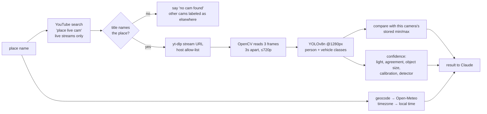

# Live crowd check: computer vision design

`check_live_conditions("Times Square")` answers "how busy is it **right now**?" It finds a public YouTube live webcam for the place, samples 3 frames, counts people and vehicles, and reports the result **relative to that camera's normal range**, at the **place's local time**, with a **confidence level and its reasons**.

Code: [`servers/traffic_crowd_server/vision.py`](../servers/traffic_crowd_server/vision.py) (measurement), `traffic_crowd_server.py` (stream reading), `claude_orchestrator.py` (`_check_live_conditions`, 45s hard limit).

---

## 1. Pipeline



Example output (live, Shibuya, Nov 12, 2026):
```json
{"camera": {"title": "…Shibuya Scramble Crossing live camera", "url": "https://www.youtube.com/watch?v=…"},
 "local_time_at_place": {"timezone": "Asia/Tokyo", "local_time": "2026-11-13 06:51", "weekday": "Friday"},
 "measurement": {"detector": "YOLOv8n", "people": {"average": 14.3, "per_frame": [13, 15, 15]},
   "vehicles": {"average": 8.7}, "counts_are_lower_bound": false,
   "relative_to_this_camera": {"people": {"level": "calibrating", "observations": 1}},
   "confidence": {"level": "medium", "reasons": ["no normal range for this camera yet…"]}}}
```

---

## 2. The four trust fixes, and why each one

### 2.1 Local time from the place's coordinates
**Problem:** the server's clock is not the place's clock. At 4:50 pm in Virginia it's 6:50 am **the next day** in Tokyo. "Quiet at 6:50 am" is normal. "Quiet at 4:50 pm" would mean something else.

**How:** Nominatim gives coordinates. Open-Meteo's forecast API with `timezone=auto` returns the IANA timezone for them (`Asia/Tokyo`), and Python's `zoneinfo` converts it. If a landmark doesn't geocode ("Shibuya Crossing"), the name is shortened until it does ("Shibuya"), because the area is enough to get the timezone.

**Why Open-Meteo and not a timezone library:** it's already a dependency (weather tool), it's free with no key, and the alternative (`timezonefinder`) adds a ~50 MB polygon dataset. A wrong timezone only affects the label, so a network dependency here is acceptable.

### 2.2 Score each camera against its own range
**Problem:** absolute counts can't be compared across cameras. 40 people is quiet for a wide Times Square shot and packed for a café cam. Zoom, angle, height and resolution all change the count.

**How:** every reading is stored per camera (keyed by YouTube video ID) in `traffic_crowd_data/camera_baselines.json`. Once a camera has **5 readings**, today's count is placed in its observed range: `score = (count − min) / (max − min)` → quiet < 0.25 ≤ moderate < 0.5 ≤ busy < 0.75 ≤ very busy, plus "busier/quieter than ever seen on this camera" outside the range.

**Design decisions:**
- **Readings < 30 minutes apart replace each other.** Otherwise ten checks in one minute would fake a "normal range" that only covers one minute of one day.
- **Narrow ranges aren't ranked.** If a camera always shows 0–1 people, the result is "typical for this camera", not a fake "busy".
- **Until calibrated, it says "calibrating"** and gives counts only. The model is told to say so instead of guessing.
- **Why min/max and not percentiles:** easy to explain and fine at small sample sizes. With hundreds of readings, p10/p90 would resist outliers better (a parade day becomes the max forever). Stored history is capped at 500 readings.
- **Why this also fixes detector bias:** a detector that misses half the people on a high, wide camera misses about half **every time**. Comparing that camera only with itself cancels most of the bias. This is the same reason anomaly detection uses per-host baselines instead of global thresholds.
- **Production version:** a scheduled sampler (EventBridge → Lambda/ECS task every hour) would build baselines by hour-of-week, so "busy for a Saturday 2 pm" becomes possible. DynamoDB instead of a JSON file.

### 2.3 A real detector: YOLOv8n
**Problem:** the old pipeline used three classic OpenCV heuristics:
| Old method | What it actually counts | Failure |
|---|---|---|
| `SimpleBlobDetector` "crowd" | Any dark/bright spot of a certain size | Signs, windows and lights count as people |
| Canny edges + contours "vehicles" | Any closed shape > 500 px² | Buildings and billboards count as cars |
| HOG + linear SVM (Dalal–Triggs, 2005) | Upright, unoccluded, mid-sized pedestrians | Misses small, seated, overlapping and side-on people |

Measured on the same live Shibuya frames: **HOG ≈ 1 person; YOLOv8n ≈ 14–30 people.**

**Why YOLOv8n specifically:**
| Option | Why / why not |
|---|---|
| **YOLOv8n (chosen)** | One-stage detector trained on COCO, which has `person`, `car`, `bus`, `truck`, `motorcycle` and `bicycle`. Smallest variant: 6.2 MB, 3.2M params, about 0.2 s per 1280px frame on a laptop CPU, no GPU needed. Mature, widely used, simple API |
| Larger YOLO (s/m/l/x) | Better small-object accuracy at 3–20× the compute. Worth it with a GPU; not for a CPU container that checks 3 frames on demand |
| Faster R-CNN, DETR | More accurate on some benchmarks, but much slower on CPU; DETR needs more tuning |
| Crowd-counting models (CSRNet, density maps) | **The right tool for dense crowds** seen from far away, because they estimate density instead of drawing a box per person. No vehicle counts, and fewer maintained packages. Next step if dense crowds become the main use |
| Cloud vision APIs (Rekognition, Google Vision) | Good accuracy, but cost per image, and frames of public places leave our infrastructure. A privacy question for some deployments |
| Keep HOG | Free and tiny, but the numbers were wrong in the direction that matters (it said "quiet" for crowded places). **Kept only as a fallback** so the tool still answers, labeled as such, when YOLO can't load |

**Settings and why:** `imgsz=1280` because city cams are wide shots and at 640 the model found **0** people in a Times Square frame. `conf=0.25` is the standard recall/precision balance for counting. Only person and vehicle classes are counted.

**Honest limit, measured:** on a dusk Times Square frame with rain on the lens, shot from high up, people are about 5 px tall. No setting found them reliably (0–2 people, 6–11 vehicles). Tiled inference (SAHI-style) didn't fix it either. So the tool now **detects this case and says so** (next section) instead of reporting "0 people = quiet".

### 2.4 Confidence with reasons
Starting from **high**, each problem lowers confidence (1 problem point → medium, 2+ → low), and every reason is returned so the model can say *why*:
| Signal | How it's measured | Weight |
|---|---|---|
| Dark stream | Mean gray level < 50/255 | 2 |
| Frames disagree | Std dev / mean of people per frame > 0.5 (or > 0.25 → 1) | 2 |
| Objects too small | Median box height < 5% of the frame, **or** ≥ 3 vehicles but 0 people (on a street, people are hidden, not absent) → `counts_are_lower_bound: true` | 2 |
| Too few frames | < 3 frames read | 1 |
| Not calibrated | Camera has < 5 past readings | 1 |
| Fallback detector | HOG in use | 1 |

The orchestrator tells Claude: give the counts, the level relative to this camera, and **always** the confidence and its reasons, in the place's local time.

---

## 3. Security of the CV pipeline

| Risk | Control |
|---|---|
| **Malicious model weights.** `.pt` files are Python pickles; loading one can run arbitrary code | Weights pinned by **SHA-256** and checked before every load. A mismatch disables YOLO (fail closed to HOG) instead of loading the file. Docker fetches and verifies at build time, so the running container never downloads code-bearing files |
| **Compromised package.** ultralytics 8.3.41 and 8.3.42 on PyPI shipped a crypto miner (Dec 2024, via a poisoned GitHub Actions build) | `ultralytics==8.4.211` pinned **exactly**; upgrades are a deliberate, reviewed change; pip-audit in CI |
| Dependency confusion when adding the PyTorch index | Docker uses `--index-url` for torch only, never `--extra-index-url` |
| Phone-home | `YOLO_OFFLINE=1` (no update checks) and ultralytics analytics `sync` turned off |
| SSRF via video URL | Exact host allow-list (youtube.com, youtu.be); http(s) only |
| Search-term injection into yt-dlp | Place name reduced to letters, digits and basic punctuation, 80 characters max, used only as `ytsearch` text |
| Wrong camera presented as the place | A camera counts only if its title names the place; others are labeled "possibly elsewhere" |
| Resource exhaustion | 3 frames, ≤ 720p stream, 45s hard timeout, model loaded once (thread-safe) |
| Parsing untrusted media | ffmpeg/OpenCV parse attacker-influenced streams. Residual risk: run CV in a separate sandboxed task with no credentials |
| Baseline file integrity | Atomic writes (temp file + rename), size capped, lock for concurrent writers, git-ignored |
| Privacy | Frames are processed in memory and never stored; only counts are kept. No faces or identities, just class counts |

---

## 4. Verification (Nov 12, 2026)

| Test | Result |
|---|---|
| Shibuya live cam | 14–30 people, 4–9 vehicles; Tokyo local time (06:51 Fri) while the server was at 4:51 pm Thu |
| Times Square (dusk, rain on lens) | 0 people, ~10 vehicles → `counts_are_lower_bound: true`, confidence **low** with reasons |
| Repeat check within 30 min | Replaces the last reading (no fake calibration) |
| Tampered weights (wrong SHA-256) | YOLO refused; HOG fallback used and labeled |
| All-black frame | Confidence low: "stream is dark" |
| Bandit | 0 medium/high findings |
| Latency | 5–8 s per check (first call ~9 s while the model loads) |

---

## 5. Interview questions this answers

- **Why not just trust the number of people detected?** Counts depend on the camera, so the tool only judges busyness relative to the same camera, and flags when counts are a lower bound.
- **Why YOLO over HOG?** HOG finds upright, mid-sized pedestrians; on real city cams it found 1 person where YOLO found 14–30. YOLO also counts vehicles properly instead of "any closed shape".
- **Why the nano model?** CPU only, on-demand, 3 frames: 0.2 s per frame matters more than a few points of accuracy. With a GPU, I'd use a larger variant.
- **What would you use for a stadium crowd?** A density-map crowd-counting model (e.g., CSRNet). Box detectors break down when people overlap heavily.
- **What's the security risk of ML models?** Model files can be code (pickles), and ML packages have been hijacked (ultralytics, Dec 2024). Pin versions, verify hashes, fetch at build time, prefer safetensors/ONNX formats where possible.
- **How would you validate accuracy properly?** Hand-label ~100 frames from 10 cameras at different times; measure count error (MAE) per camera and how often the busy/quiet label matches a human's.
- **Is this privacy-safe?** No frames are stored and no one is identified; only class counts. In production, I'd add a data-retention note and avoid sending frames to third parties.
